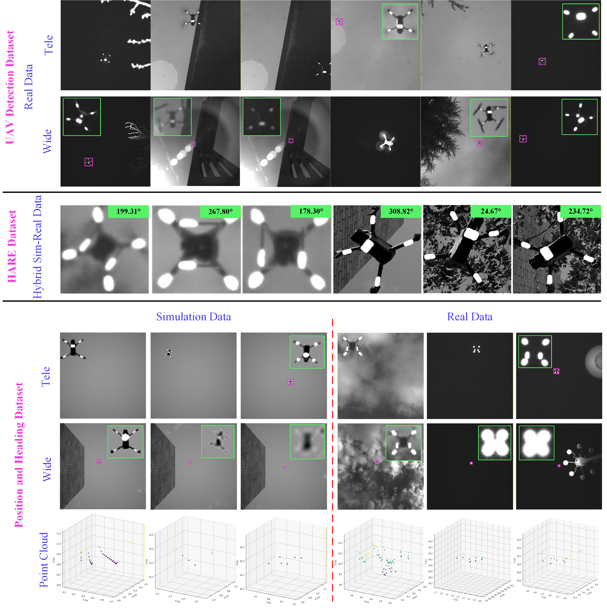

  <strong>English</strong> | <a href="./README.zh-CN.md">简体中文</a>

<h1 align="center">Joint 3D Position and Heading Estimation of Low-Altitude UAVs Using Ground-Based Dual-Camera-LiDAR Fusion</h1>

  <strong>Feiya Wang</strong> · <strong>Tao Yang</strong> · <strong>Ning Geng</strong> ·
  <strong>Jiaxin Yang</strong> · <strong>Hongwei Bao</strong> · <strong>Dongdong Li</strong> ·
  <strong>Negaar Rezvanfar</strong> · <strong>Olunloyo David</strong> · <strong>Jing Li</strong>

  <strong>Real and simulated data for UAV detection, visual heading estimation, and 3D localization.</strong>

  <a href="#overview">Overview</a> ·
  <a href="#demo">🎬 Demo</a> ·
  <a href="#dataset-summary">Datasets</a> ·
  <a href="#reference-frames-and-evaluation">Reference Frames</a> ·
  <a href="#dataset-access">Download</a> ·
  <a href="#contact">Contact</a>

<h2 align="center">🎬 System demonstration</h2>

  

## 🔎 Overview

This repository introduces the datasets used in our study of **ground-based UAV position and heading estimation**. The collection combines real near-infrared imagery, LiDAR point clouds, and AirSim-generated observations for three tasks: **UAV detection**, **visual heading estimation**, and **joint 3D position and heading evaluation**.

The observation station combines a **wide-angle camera** for spatial coverage, a **telephoto camera** for target detail, and a **LiDAR sensor** for metric depth. The real-world data were collected using DJI Air 3S and Phantom 4 RTK UAVs. 

  

## 🎬 Demo

Watch the demonstration of the ground-based dual-camera–LiDAR system:

[▶️ Watch or download the demo](./assets/demo.mp4)

## 📊 Dataset Summary

The collection contains three independent datasets. The Position and Heading Dataset has separate simulated and real-world subsets.

| Dataset | Data source | Size | Intended use |
| :--- | :--- | ---: | :--- |
| [UAV Detection](#uav-detection-dataset) | DJI Air 3S | 8,826 images | Camera-specific detector training and evaluation |
| [HARE](#hare-dataset) | AirSim simulation and real near-infrared imagery | 8,147 images | Visual heading estimation and domain adaptation |
| [Position and Heading — Simulation](#position-and-heading-dataset) | AirSim simulation | 4,435 frames | Joint position and heading evaluation |
| [Position and Heading — Real World](#position-and-heading-dataset) | DJI Phantom 4 RTK | More than 16,000 frames | Joint position and heading evaluation |

> **Counting convention:** an *image* is a single camera observation. A *frame* in the Position and Heading Dataset contains two images—one from each camera—one LiDAR point cloud, and the corresponding position and heading references.

## 🚁 UAV Detection Dataset

The UAV Detection Dataset contains **8,826 near-infrared images** of the DJI Air 3S, collected at altitudes of **10–50 m**. It includes variations in target scale, illumination, background appearance, and occlusion.

Images are organized into **telephoto** and **wide-angle** subsets. The paper trains a separate detector for each camera to account for differences in apparent target size and image detail.

| Camera subset | Training images | Evaluation images | Total |
| :--- | ---: | ---: | ---: |
| Telephoto | 4,131 | 1,036 | 5,167 |
| Wide-angle | 2,925 | 734 | 3,659 |
| **Total** | **7,056** | **1,770** | **8,826** |

## 🧭 HARE Dataset

The HARE Dataset contains **8,147 images** for training and adapting the visual heading-estimation model. Most images are collected in the AirSim-based Unreal Engine environment, supplemented with a small subset of **real-world near-infrared observations for domain adaptation**. Wide-angle and telephoto observations are pooled to capture variation in target scale, marker detail, and surrounding appearance across simulated and real imaging conditions.

| Property | Description |
| :--- | :--- |
| Data composition | Primarily simulated images, supplemented with a small real-world near-infrared subset |
| Simulation environment | AirSim and Unreal Engine |
| Flight altitudes | 10–50 m |
| Backgrounds | Clear sky, trees, and buildings |
| Camera views | Wide-angle and telephoto |
| Heading labels | Derived from simulated UAV states or aligned onboard records |

Each image is associated with a reference heading obtained from the simulated UAV state or aligned onboard records. The yaw component is expressed using the unified heading convention of the physical observation system.

## 📍 Position and Heading Dataset

This dataset supports evaluation of the **complete dual-camera–LiDAR system**. Each frame contains:

- A wide-angle image.
- A telephoto image.
- A LiDAR point cloud.
- Corresponding UAV position and heading references.

### Simulated Sequences

The simulated subset contains **4,435 frames**. Sequences were collected at **10, 20, 30, 40, and 50 m**.

Images are rendered at **1024 × 1024 pixels**. Position and heading references are obtained from the simulated vehicle state.

### Real-World Sequences

The real-world subset contains **more than 16,000 frames** recorded with a DJI Phantom 4 RTK and the ground observation station. Sequences cover the same five flight altitudes as the simulated subset.

| Collection condition | Description |
| :--- | :--- |
| Daytime | Clear-sky flight recordings |
| Nighttime | Clear-sky flight recordings |
| Nighttime with background lights | Flight recordings with additional background light sources |

Both cameras record images at **2048 × 2048 pixels**, and point clouds are acquired by the **Livox Mid-70**. UAV reference records are aligned with the station's coordinate and heading.

## 📐 Reference Frames and Evaluation

### Position References

Real-flight GNSS positions are converted from **WGS84** to a local **east–north–up (ENU)** frame, with the takeoff point as the origin. A rigid transformation aligns these positions with the **LiDAR coordinate frame**.

### Heading References

The heading convention is shared by the simulated labels and the physical observation system:

- **Zero heading:** the positive LiDAR x-axis, corresponding to the UAV nose pointing upward in the reference image.
- **Positive direction:** clockwise rotation in the reference image.

## 📥 Dataset Access

The self-collected and simulated datasets will be made publicly available **upon acceptance of the paper**. Download links will be added to this repository at that time.

## 📬 Contact

[Contact us](https://robot-vision.net/)
