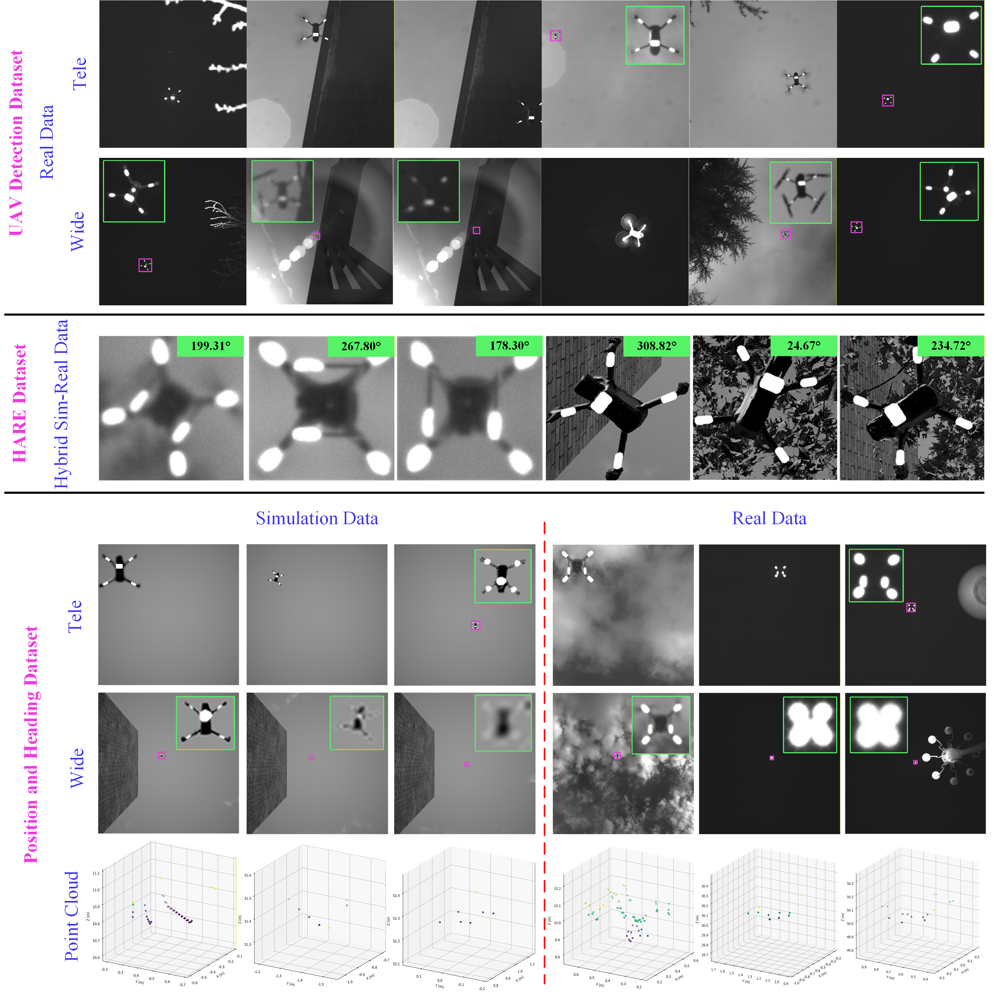

  <a href="./README.md">English</a> | <strong>简体中文</strong>

<h1 align="center">基于地基双相机–LiDAR融合的低空无人机三维位置与航向联合估计</h1>

  <strong>王飞亚</strong> · <strong>杨涛</strong> · <strong>耿宁</strong> ·
  <strong>杨佳欣</strong> · <strong>鲍宏伟</strong> · <strong>李冬冬</strong> ·
  <strong>Negaar Rezvanfar</strong> · <strong>Olunloyo David</strong> · <strong>李静</strong>

  <strong>面向无人机检测、视觉航向估计与三维定位的真实及仿真数据。</strong>

  <a href="#overview">概览</a> ·
  <a href="#demo">🎬 演示</a> ·
  <a href="#dataset-summary">数据集</a> ·
  <a href="#reference-frames-and-evaluation">参考坐标系</a> ·
  <a href="#dataset-access">下载</a> ·
  <a href="#contact">联系我们</a>

<h2 align="center">🎬 系统演示</h2>

  

## 🔎 概览

本仓库介绍我们在**地基无人机位置与航向估计**研究中使用的数据集。数据包含真实近红外图像、LiDAR点云以及AirSim生成的仿真观测，用于**无人机检测**、**视觉航向估计**和**三维位置与航向联合评估**三项任务。

地面观测站使用**广角相机**提供空间覆盖，使用**长焦相机**捕获目标细节，并通过**LiDAR**获取度量深度。真实数据由DJI Air 3S和Phantom 4 RTK无人机采集。

  

## 🎬 演示

观看地基双相机–LiDAR系统的演示视频：

[▶️ 观看或下载演示视频](./assets/demo.mp4)

## 📊 数据集概览

数据集由三个独立部分组成。其中，位置与航向数据集分别包含仿真和真实子集。

| 数据集 | 数据来源 | 规模 | 用途 |
| :--- | :--- | ---: | :--- |
| [无人机检测](#uav-detection-dataset) | DJI Air 3S | 8,826张图像 | 分相机训练与评估目标检测器 |
| [HARE](#hare-dataset) | AirSim仿真与真实近红外图像 | 8,147张图像 | 视觉航向估计与域适应 |
| [位置与航向——仿真](#position-and-heading-dataset) | AirSim仿真 | 4,435帧 | 三维位置与航向联合评估 |
| [位置与航向——真实](#position-and-heading-dataset) | DJI Phantom 4 RTK | 超过16,000帧 | 三维位置与航向联合评估 |

> **计数方式：** 一张图像对应单台相机的一次观测。位置与航向数据集中的一帧包含两张图像（广角和长焦各一张）、一份LiDAR点云，以及对应的位置和航向参考值。

## 🚁 无人机检测数据集

无人机检测数据集包含DJI Air 3S的**8,826张近红外图像**，采集高度为**10–50 m**，涵盖目标尺度、光照、背景和遮挡条件的变化。

图像分为**长焦**和**广角**两个子集。论文分别为两台相机训练检测器，以适应目标成像尺度与图像细节的差异。

| 相机子集 | 训练图像 | 评估图像 | 合计 |
| :--- | ---: | ---: | ---: |
| 长焦 | 4,131 | 1,036 | 5,167 |
| 广角 | 2,925 | 734 | 3,659 |
| **总计** | **7,056** | **1,770** | **8,826** |

## 🧭 HARE数据集

HARE数据集包含用于视觉航向估计模型训练与适应的**8,147张图像**，主要采集自基于AirSim的Unreal Engine仿真环境，并补充少量**真实近红外观测用于域适应**。广角与长焦观测混合使用，以涵盖仿真与真实成像条件下目标尺度、标记细节及周围背景的变化。

| 属性 | 说明 |
| :--- | :--- |
| 数据组成 | 以仿真图像为主，补充少量真实近红外图像 |
| 仿真环境 | AirSim与Unreal Engine |
| 飞行高度 | 10–50 m |
| 背景 | 净空、树木和建筑物 |
| 相机视角 | 广角与长焦 |
| 航向标签 | 来自仿真无人机状态或对齐后的机载记录 |

每张图像均对应一个由仿真无人机状态或对齐后的机载记录获得的航向参考值，其中偏航分量采用真实观测系统的统一航向定义。

## 📍 位置与航向数据集

该数据集用于评估**完整的双相机–LiDAR系统**。每帧包含：

- 一张广角图像。
- 一张长焦图像。
- 一份LiDAR点云。
- 对应的无人机位置与航向参考值。

### 仿真序列

仿真子集包含**4,435帧**，分别在**10、20、30、40和50 m**高度采集。

图像渲染分辨率为**1024 × 1024像素**。位置与航向参考值来自仿真无人机状态。

### 真实序列

真实子集包含使用DJI Phantom 4 RTK与地面观测站采集的**超过16,000帧**数据，覆盖与仿真子集相同的五个飞行高度。

| 采集条件 | 说明 |
| :--- | :--- |
| 白天 | 净空场景飞行记录 |
| 夜晚 | 净空场景飞行记录 |
| 夜晚有背景光源 | 存在额外背景光源的飞行记录 |

两台相机均以**2048 × 2048像素**分辨率采集图像，点云由**Livox Mid-70**获取。无人机参考记录与观测站的坐标系和航向定义对齐。

## 📐 参考坐标系与评估

### 位置参考

真实飞行的GNSS位置由**WGS84**转换至以起飞点为原点的局部**东北天（ENU）坐标系**，随后通过刚体变换与**LiDAR坐标系**对齐。

### 航向参考

仿真标签与真实观测系统使用相同的航向定义：

- **零航向：** LiDAR坐标系的x轴正方向，对应参考图像中机头竖直朝上。
- **正方向：** 参考图像中的顺时针旋转方向。

## 📥 数据集获取

自采和仿真数据集将在**论文被接收后公开提供**，届时将在本仓库更新下载链接。

## 📬 联系我们

[联系我们](https://robot-vision.net/)
